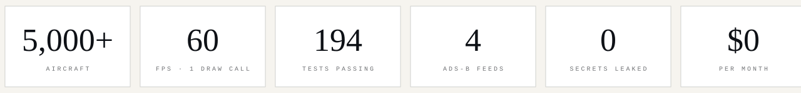
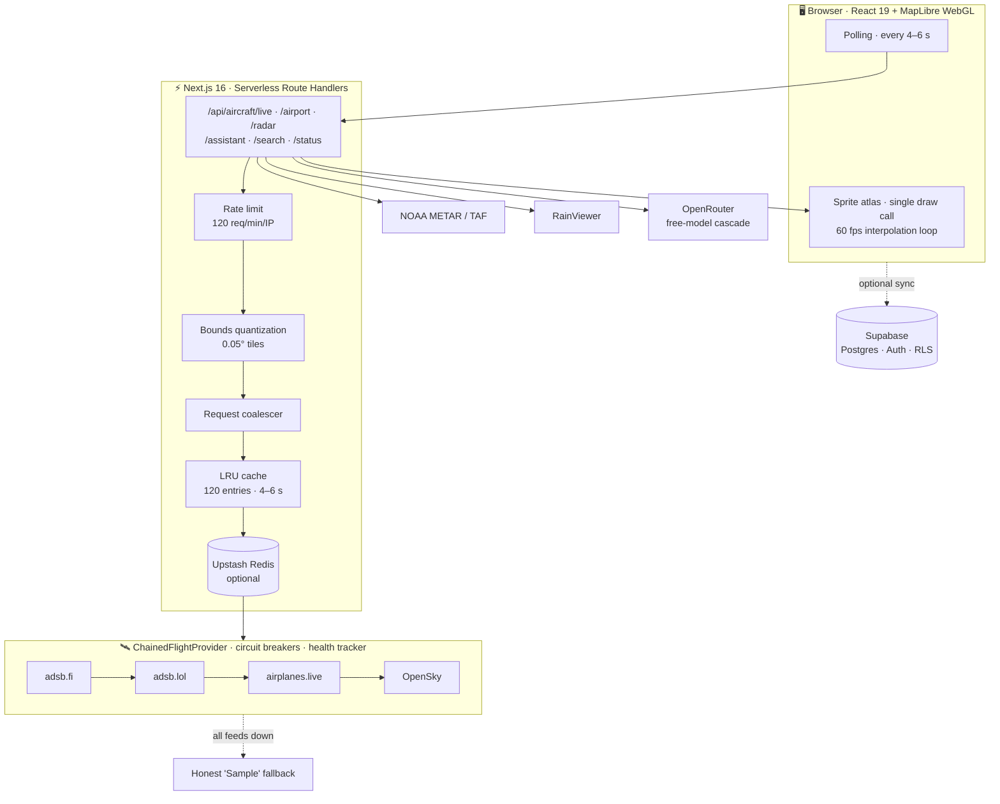
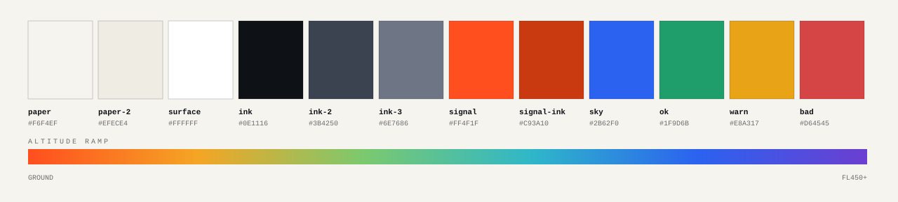

<div align="center">



<a href="https://github.com/Crusty-chirayu/Aeroloom">
  
</a>

<br />

[](https://nextjs.org)
[](https://react.dev)
[](https://www.typescriptlang.org)
[](https://maplibre.org)
[](https://tailwindcss.com)
[](https://vercel.com)


<br />

**[▶ Live Demo](#)** &nbsp;·&nbsp; **[Quick Start](#quick-start)** &nbsp;·&nbsp; **[Architecture](#architecture)** &nbsp;·&nbsp; **[Design System](#design-system)** &nbsp;·&nbsp; **[Docs](#documentation)**




</div>

<br />

## The Idea

Every flight tracker you've seen looks like a radar screen from a sci-fi film — black glass, neon green, glowing everything.

**Aeroloom is the opposite.** It draws the sky on **warm archival paper** in **deep carbon ink** and **hairline rules**, with one drop of vermilion where a transponder is talking. Think *Swiss timetable meets flight-deck instrument*: mid-century editorial cartography, wired to live ADS-B telemetry.

> **Aero** — flight, atmosphere. &nbsp;·&nbsp; **Loom** — the weaving of invisible contrails, vectors and airways across the troposphere.

It's also a serious piece of engineering: a four-provider failover chain, sub-pixel dead reckoning at 60 fps, a WebGL sprite atlas that draws 5,000+ aircraft in a single call, an anti-hallucination AI copilot, row-level-security accounts — all running on **$0/month** of free tiers.

<div align="center">

<br />


<sub><b>The landing page</b> — a cinematic, scroll-driven editorial experience over a live map.</sub>

<br /><br />


<sub><b>The live map</b> — real aircraft on paper-toned vector cartography, gliding at 60 fps.</sub>

<br />


</div>

## Why It's Different

| | Typical flight tracker | **Aeroloom** |
|---|---|---|
| **Look** | Dark HUD, neon, glass | Warm paper, ink, hairlines, one vermilion accent |
| **Motion** | Aircraft *teleport* every few seconds | Sub-pixel dead reckoning — they **glide** at 60 fps |
| **Scale** | DOM markers choke at a few hundred | **5,000+** aircraft, one WebGL draw call |
| **Reliability** | One upstream, one outage | **4-provider** chain with circuit breakers |
| **Honesty** | Invented routes, fake "estimated" data | Unknown stays **unknown**. Unfiled GA says so. |
| **AI** | Free-form chatbot, confident nonsense | **Grounded** on live tool output, injection-hardened |
| **Cost** | Paid map + API keys | **$0/month**, no keys needed to run locally |
| **Sharing** | Screenshots | **The URL is the state** — every view is a link |

<br />

## Features

<table>
<tr>
<td width="50%" valign="top">

### 🛰 Live ADS-B Intelligence
- **adsb.fi → adsb.lol → airplanes.live → OpenSky**, automatic cascading failover
- Per-provider **circuit breakers** (60 s trip) · negative cache (3 s) · health tracking
- **Request coalescing** — 1,000 viewers, **one** upstream call
- **Viewport quantization** to 0.05° tiles for shared cache hits
- Stale aircraft fade at 60 s, vanish at 180 s
- If every feed dies you get a clearly-labelled *Sample* — never fakes passed off as real

</td>
<td width="50%" valign="top">

### 🗺 Editorial Map
- **MapLibre GL JS** with a hand-tuned light style — no Mapbox, no map keys
- **Sub-pixel dead reckoning** between ADS-B bursts
- Colour by **ink · altitude (6-stop ramp) · speed**
- Hover tag in **< 50 ms** · side panel (420 px) or 3-snap **bottom sheet** on mobile
- **Follow mode** locks the camera to one aircraft
- `/map?lat=…&lng=…&z=…&flight=…` — **URL is the state**

</td>
</tr>
<tr>
<td valign="top">

### ✈ 11 Hand-Crafted Silhouettes
Narrowbody · Widebody Twin · Quad · Regional Jet · Turboprop · Business Jet · Light GA · Helicopter · Cargo · Military · Unknown

Each drawn top-down on a **64×64 grid**, in **6 states** — default, selected, hover, stale, on-ground, emergency — baked into a **WebGL sprite atlas**.

</td>
<td valign="top">

### 🌧 Doppler Radar Overlay
- RainViewer precipitation, **13-frame timeline** (2 h, 10-min steps)
- Scrubber with play / pause / keyboard control
- In-place tile swapping — no map re-init
- **Measured: radar OFF 59 FPS → ON 60 FPS.** Zero penalty.

</td>
</tr>
<tr>
<td valign="top">

### 📋 Flight Dossiers
- Big display-type route (`BLR → LHR`) with the aircraft at its true position
- Monospace stat grid — altitude, speed, vertical rate, heading, squawk
- **Hand-built SVG** sparklines with draw-in animation (no chart library)
- Track mini-map + technical blueprint of the airframe
- Missing fields collapse gracefully — no walls of "N/A"

</td>
<td valign="top">

### 🛬 Airport Pages
- Live **METAR decoded** into plain language with a wind arrow
- **VFR / MVFR / IFR / LIFR** category chip
- **Canvas ATC radar scope** — rotating sweep, 30° spokes, range rings, accessible table fallback
- Nearby live traffic and local time

</td>
</tr>
<tr>
<td valign="top">

### 🤖 Ask Aeroloom — Grounded AI
- Every answer built from **typed server tools** loading live ADS-B + NOAA METAR into immutable XML blocks
- **Prompt-injection defence**: control chars stripped, tags neutralised, delimiters escaped, length bounded
- **Free-model cascade**: Llama 3.3 70B → Gemini 2.0 Flash → Qwen 2.5 72B (20 s per hop)
- SSE streaming + sources disclosure · **20 eval scenarios**

</td>
<td valign="top">

### 🚨 Alerts · ⌘K · Sync
- Deterministic **alert engine**: squawk 7700/7600/7500, FL400 ceiling, watchlist matches — 120 s freshness guard, 5-min cooldown
- **Command palette** across flights, airports, airlines
- **Two-tier persistence**: local-first JSON, or Supabase sync with full **RLS** — one `IPersistenceAdapter` interface

</td>
</tr>
</table>

<br />

## The Landing Page, Scene by Scene

A seven-act, scroll-choreographed experience built with GSAP, ScrollTrigger and Lenis — and no scroll-jacking that fights you.

| Act | Scene | What happens |
|:-:|---|---|
| **I** | **Preloader Arc** | A hairline great-circle arc draws across the paper, an aircraft rides it, a mono counter ticks to the live aircraft count. ≤ 1.1 s, skippable. |
| **II** | **Hero** | *"Every flight. Right now."* — line-masked headline over a live map with real aircraft, a ticking stat strip, a search field that opens ⌘K. |
| **III** | **Follow One Flight** | A pinned **300 vh** story: a long-haul route scrubs along its great circle through **Takeoff → Cruise → Descent** with altitude and speed tickers. |
| **IV** | **Capabilities Bento** | Asymmetric 12-column grid of *live* components — mini map, altitude ramp, radar scope, airport board, search, delay indicator. |
| **V** | **Split-Flap Board** | A mechanical departures board, character-by-character flips with 30–50 ms stagger, cycling four real hubs. |
| **VI** | **Aircraft Library** | A typographic specimen of all 11 silhouettes — hover to reveal blueprint linework. |
| **VII** | **Trust & Data** | A frank account of sources, coverage and limits. Then a giant serif wordmark and *Open the live map*. |

<div align="center">

<br />



<br />

</div>


## Architecture



**The six rules it's built on**

1. **Server-side upstream only** — browsers never call external APIs.
2. **Double-layer caching** — in-memory LRU plus optional Redis.
3. **Progressive enhancement** — no Redis, no Supabase, no OpenRouter? Still runs. Each adds, none is required.
4. **Swappable sources** — everything sits behind the `FlightProvider` interface.
5. **Honesty over polish** — unknown stays unknown.
6. **Defensive edges** — strict CSP, server-side WGS84 validation, SSRF-safe numeric coercion.

<details>
<summary><b>Life of a request — 1,000 people looking at Europe</b></summary>

<br />

1. Each browser asks `/api/aircraft/live` for its viewport.
2. Bounds are **quantized to 0.05° tiles**, so every nearby viewport maps to the same cache key.
3. The **coalescer** collapses simultaneous identical queries into one in-flight Promise.
4. Cache hit (LRU → Redis)? Return instantly.
5. Miss? **One** call goes to adsb.fi. If it fails, the circuit breaker trips and the chain falls to adsb.lol, then airplanes.live, then OpenSky.
6. The response fans back out to all 1,000 viewers, and the client interpolates positions between bursts at 60 fps.

**1,000 viewers → 1 upstream request.**

</details>

## Design System

> **Editorial Aviation** — light mode only, by conviction.

<div align="center">

</div>

| | |
|---|---|
| **Type** | **Instrument Serif** (display, roman/italic rhythm) · **Geist Sans** (UI) · **Geist Mono** (data, `tabular-nums` on everything that moves) |
| **Surface** | 3 % static paper grain · 1 px hairlines over shadows · only **3** shadow tokens |
| **Rhythm** | 4 px base · 8 pt grid · 1360 px max · radii 8 / 14 / 22 / pill |
| **Accent** | ~85 % neutral, **one vermilion moment per screen** |
| **Motion** | micro 120–180 ms · UI 240–360 ms · reveals 700–1100 ms · only `transform`, `opacity`, `clip-path` |
| **Access** | `prefers-reduced-motion` honoured with *designed* 200 ms fade alternatives |
| **Brand** | Original woven-thread mark: flight vector (weft) × loom cross-weave (warp) × vermilion transponder dot |

**What Aeroloom refuses to do:** dark mode · gradient blobs · neon glow · glassmorphism · cursor-reactive backgrounds · scroll-jacking · decorative 3D · emoji-as-icons · fake data · "Unleash the power of…" copy · layout shift · console noise.


## Engineering Rigor

Every gate passes on `main`.

| Gate | Result |
|---|---|
| TypeScript strict, zero `any` | **0 errors** |
| ESLint | **0 errors · 0 warnings** |
| Tests | **194 / 194** across 50 suites |
| Accessibility (axe-core · WCAG 2.2 AA) | **0 critical · 0 serious** over 16 routes |
| Responsive overflow | **50 / 50** at 360 · 390 · 768 · 1280 · 1728 px |
| Secrets scan | **0** found in 210 files |
| Production build | **31 / 31** routes |
| Launch-readiness audit | **4 / 4** |

| Lighthouse | Accessibility | Best Practices | SEO |
|---|:-:|:-:|:-:|
| `/` | 98 | 100 | 100 |
| `/map` | **100** | **100** | **100** |
| `/flight/DAL397` | **100** | 96 | **100** |
| `/airport/KJFK` | **100** | **100** | **100** |

| Performance | |
|---|---|
| Aircraft capacity | **5,000+ @ 60 fps**, single draw call |
| Radar overlay cost | **0 FPS** (59 → 60) |
| Hover tag | **< 50 ms** |
| Interaction feedback | **< 100 ms** |
| Cache TTL | ADS-B 4–6 s · METAR 60 s · radar index 5 min |

**Security:** zero secrets in client bundles · RLS on every table (`auth.uid() = user_id`) with cross-user isolation verified against a live instance · SSRF-safe coordinates · prompt-injection defence · 120 req/min sliding-window rate limit · strict CSP · automated leak scanning. See [`docs/SECURITY-AND-RLS.md`](docs/SECURITY-AND-RLS.md).

## Tech Stack

| | |
|---|---|
| **App** | Next.js 16.3.6 (App Router, Turbopack) · React 19.2.8 · TypeScript 5 strict |
| **Style** | Tailwind CSS v4 · CSS-variable design tokens · Radix UI · cmdk · Lucide + custom aviation icons |
| **Map** | MapLibre GL JS 6.11.2 · OpenFreeMap / CARTO vector tiles |
| **Motion** | GSAP 3.15 + ScrollTrigger · Framer Motion 13.4 · Lenis 1.3 |
| **Data** | Supabase (Postgres · Auth · RLS) · Upstash Redis · NOAA · RainViewer |
| **AI** | OpenRouter free-tier cascade |
| **Quality** | Node test runner · Playwright · axe-core · Lighthouse |
| **Hosting** | Vercel Hobby |

## Quick Start

**No accounts. No API keys.**

```bash
git clone https://github.com/Crusty-chirayu/Aeroloom.git
cd Aeroloom
cp .env.example .env.local
npm install && npm run dev
```

Open **http://localhost:3000** — live aircraft in under a minute. *(Node 20.x or 22.x.)*

| Optional service | Unlocks | Variables |
|---|---|---|
| **Upstash Redis** | Cache survives restarts | `UPSTASH_REDIS_REST_URL` `UPSTASH_REDIS_REST_TOKEN` |
| **Supabase** | Accounts, cloud sync, watchlists | `NEXT_PUBLIC_SUPABASE_URL` `NEXT_PUBLIC_SUPABASE_ANON_KEY` |
| **OpenRouter** | *Ask Aeroloom* AI | `OPENROUTER_API_KEY` |

```bash
npm run build         # production build
npm test              # 194 tests
npm run lint          # ESLint
npm run check:env     # validate Supabase creds & reachability
npm run check:launch  # full pre-flight launch audit
```

<details>
<summary><b>Project structure</b></summary>

```text
Aeroloom/
├── app/                      # App Router · pages · API routes · OG images (31 routes)
├── components/
│   ├── landing/              # PreloaderArc · Hero · FollowFlight · Bento · SplitFlap · Library
│   ├── map/                  # FlightMap (WebGL layer) · controls · hover tag · radar timeline
│   ├── flight/               # Panel · profile charts · sparklines · mini-map
│   ├── airport/              # Canvas radar scope · METAR card
│   ├── assistant/            # Ask Aeroloom
│   ├── brand/                # Woven-thread logo, 4 variants × 4 sizes
│   └── ui/                   # 11 restyled primitives + ⌘K palette
├── lib/
│   ├── providers/            # 4 feeds · chained failover · health tracker · quantization
│   ├── alerts/ assistant/ storage/ supabase/ cache/ weather/ routes/ search/ map/ motion/
├── hooks/useLiveAircraft.ts  # polling + 60 fps interpolation
├── supabase/migrations/      # schema + RLS policies
├── tests/                    # 26 files
├── scripts/                  # 25 audit / benchmark / validation scripts
└── docs/                     # 27 documents
```

</details>

<details>
<summary><b>All routes</b></summary>

| Route | |
|---|---|
| `/` | Cinematic landing |
| `/map` | Live map — the core product |
| `/flight/[flightId]` | Flight dossier |
| `/airport/[code]` · `/airports` | Airport page · directory |
| `/search` | Full search |
| `/about` · `/about/data` | Case study · data transparency |
| `/status` | Live system health |
| `/contact` · `/credits` | Contact · attributions |
| `/terms` `/privacy` `/cookies` `/disclaimer` `/accessibility` | Legal suite |

</details>

## Deploy for $0

1. Push to GitHub
2. Import into **Vercel** (framework: Next.js)
3. Paste variables from `.env.example`
4. Deploy

| Vercel Hobby | Supabase Free | Upstash Free | OpenRouter free models | Open ADS-B feeds | NOAA · RainViewer · OSM |
|:-:|:-:|:-:|:-:|:-:|:-:|
| $0 | $0 | $0 | $0 | $0 | $0 |

Full runbook → [`docs/DEPLOY.md`](docs/DEPLOY.md)


## Data Sources & Attribution

Aeroloom stands on open data. Please keep these credits if you fork.

| Source | Role | License | Credit |
|---|---|---|---|
| [adsb.fi](https://adsb.fi) | Primary ADS-B | Open community | Flight data courtesy of the adsb.fi open feeder network |
| [adsb.lol](https://adsb.lol) | Failover | Open-source | ADS-B telemetry aggregated via adsb.lol open collective |
| [airplanes.live](https://airplanes.live) | Secondary | Free for open-source | Flight data courtesy of airplanes.live community feeders |
| [OpenSky Network](https://opensky-network.org) | Tertiary | CC BY 4.0 | Data provided by The OpenSky Network |
| [NOAA / NWS](https://aviationweather.gov) | METAR | US Public Domain | Aviation meteorological observations provided by NOAA / NWS |
| [OpenFreeMap](https://openfreemap.org) + OSM | Basemap | ODbL | © OpenStreetMap contributors |
| [RainViewer](https://www.rainviewer.com) | Radar | Free, non-commercial | Radar imagery © RainViewer |
| [OpenRouter](https://openrouter.ai) | AI inference | Model-specific | Inference powered by OpenRouter free model router |

> [!WARNING]
> **Not for navigation.** Aeroloom is informational and educational. ADS-B data is community-sourced and may be delayed, incomplete or wrong. Never use it for flight planning or any safety-critical decision.

## Documentation

| | |
|---|---|
| [`DESIGN_SPEC.md`](DESIGN_SPEC.md) | 302-line master design specification |
| [`docs/ARCHITECTURE.md`](docs/ARCHITECTURE.md) | System blueprint |
| [`docs/BRAND.md`](docs/BRAND.md) | Logo geometry, tokens, anti-patterns |
| [`docs/AEROLOOM_DESIGN_SYSTEM.md`](docs/AEROLOOM_DESIGN_SYSTEM.md) | Design system spec |
| [`docs/DEPLOY.md`](docs/DEPLOY.md) · [`docs/AUTH_SETUP.md`](docs/AUTH_SETUP.md) | Deployment · Auth & OAuth |
| [`docs/SECURITY-AND-RLS.md`](docs/SECURITY-AND-RLS.md) | Row Level Security |
| [`docs/data-sources.md`](docs/data-sources.md) | Attribution register |
| [`FINAL_REPORT.md`](FINAL_REPORT.md) · [`docs/QA-ACCEPTANCE-REPORT.md`](docs/QA-ACCEPTANCE-REPORT.md) | Delivery & QA reports |

## Contributing

PRs welcome — especially new `FlightProvider` adapters, aircraft silhouettes and accessibility fixes.

```bash
git checkout -b feat/your-idea
# read DESIGN_SPEC.md + docs/BRAND.md first — the rules are strict on purpose
npm run lint && npx tsc --noEmit && npm test
```

**House rules:** light theme only · animate `transform` / `opacity` / `clip-path` only · TypeScript strict, no `any` · respect `prefers-reduced-motion` · no mocked data presented as real.

## License

MIT — see [`LICENSE`](LICENSE). Third-party data keeps its own licenses (above).

<div align="center">

<br />


<br />

### Built by [Chirayu](https://github.com/Crusty-chirayu)
*Computer Engineering student · full-stack developer · Bangalore, India*

[Portfolio](https://portfolio-lac-kappa-49.vercel.app) &nbsp;·&nbsp; [LinkedIn](https://linkedin.com/in/chirayu-jayaswal) &nbsp;·&nbsp; [GitHub](https://github.com/Crusty-chirayu)

<sub>With thanks to the feeders behind adsb.fi, adsb.lol, airplanes.live and OpenSky; the MapLibre, OpenFreeMap and OpenStreetMap communities; NOAA and RainViewer; and the designers of Instrument Serif and Geist.</sub>

<br />

**Every flight. Right now.**

[⭐ Star Aeroloom](https://github.com/Crusty-chirayu/Aeroloom) if it made you look up.

</div>
