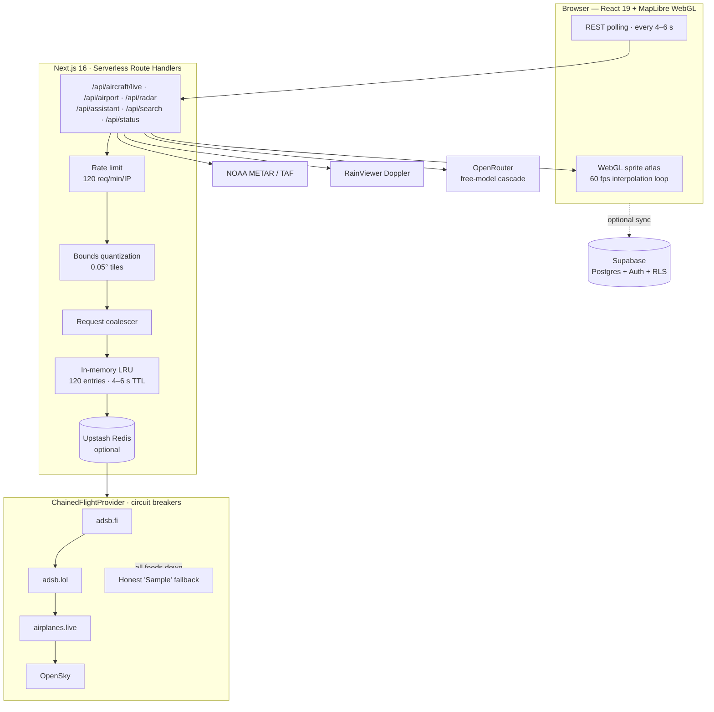

<div align="center">

<br />


<br />
<br />

# A E R O L O O M

### *Live Flight Intelligence.*

**Real-time ADS-B flight tracking with editorial cartography,<br />sub-pixel dead reckoning, and verified telemetry provenance.**

<br />

[](https://nextjs.org)
[](https://react.dev)
[](https://www.typescriptlang.org)
[](https://maplibre.org)
[](https://tailwindcss.com)

[](#-quality-gates)
[](#-quality-gates)
[](#-security)
[](#-zero-cost-infrastructure)
[](#-license)

<br />

[**Live Demo**](#) · [**Quick Start**](#-quick-start) · [**Architecture**](#-architecture) · [**Design System**](#-design-system) · [**Docs**](#-documentation)

<br />

</div>

---

## ✦ The Idea

Most flight trackers look like radar screens from a sci-fi film: dark glass, neon glow, phosphor green.

**Aeroloom does the opposite.** It renders the sky on warm archival paper, in deep carbon ink and precise hairlines — *a Swiss timetable meets a flight-deck instrument.* Mid-century editorial cartography, wired to live transponder telemetry.

> **Aero** — flight, atmosphere.
> **Loom** — the weaving of invisible contrails, vectors and airways that criss-cross the troposphere.

Paper & ink, not phosphor & glass.

<div align="center">
<br />

<br />
<sub><i>The live map — thousands of aircraft on paper-toned vector cartography, gliding at 60 fps.</i></sub>
<br />
<br />
</div>

---

## ✦ At a Glance

| | |
|---|---|
| **5,000+** | aircraft rendered at 60 fps in a single WebGL draw call |
| **4** | open ADS-B providers in a chained failover with circuit breakers |
| **11 × 6** | hand-crafted aircraft silhouettes × visual states |
| **194** | automated tests passing across 50 suites |
| **0** | critical / serious accessibility violations across 16 routes |
| **0** | secrets detected across 210 scanned files |
| **$0** | monthly infrastructure cost — entirely free tiers |
| **0 FPS** | penalty from toggling the live Doppler radar overlay (59 → 60) |

---

## ✦ Features

### 🛰 Live ADS-B Tracking
- Real telemetry from **adsb.fi** (primary) → **adsb.lol** → **airplanes.live** → **OpenSky Network**, with automatic cascading failover
- **Per-provider circuit breakers** (60 s trip), negative caching (3 s) and live health tracking
- **Sub-pixel dead reckoning** — client-side kinematic interpolation between ADS-B bursts, so aircraft *glide* instead of teleporting
- **Request coalescing** — 1,000 viewers of the same area share *one* upstream call
- **Viewport quantization** to 0.05° tiles so nearby users hit identical cache slots
- **Stale handling** — fade to 40 % opacity after 60 s, removed after 180 s
- **Honest by design** — unavailable data renders as an empty/unknown state. Unfiled GA flights read *"Route unfiled • Transponder-only telemetry"*. Zero route hallucination.

### 🗺 Editorial Map
- Full-viewport **MapLibre GL JS** with a custom light style: paper land, pale-blue water, hairline borders, muted Geist labels
- Free vector tiles (OpenFreeMap, CARTO) — **no Mapbox, no map API keys**
- **11 canonical silhouettes** on a 64×64 grid: Narrowbody · Widebody Twin · Quad · Regional Jet · Turboprop · Business Jet · Light GA · Helicopter · Cargo · Military · Unknown
- **6 states each:** default · selected (vermilion + white outline) · hover (×1.15) · stale · on-ground · emergency
- Colour by **solid ink / altitude (6-stop ramp) / speed**
- Hover tag in **< 50 ms** · click for a 420 px side panel (desktop) or 3-snap-point bottom sheet (mobile)
- **Follow mode** locks the camera to an aircraft; panning away releases it
- **The URL is the state:** `/map?lat=…&lng=…&z=…&flight=…` — every view is shareable

### 🌧 Live Weather Radar
- RainViewer Doppler precipitation, **13-frame timeline** (2 h history, 10-minute steps)
- Scrubber with play / pause, frame counter and keyboard shortcuts
- In-place `setTiles` swapping — no map re-initialisation, **no frame-rate cost**

### ✈ Flight Dossiers — `/flight/[flightId]`
- Big display-type route header (`BLR → LHR`), progress line with the aircraft at its true position
- Monospace stat grid: altitude, ground speed, vertical rate, heading, squawk
- **Hand-built SVG** altitude/speed sparklines with draw-in animation (no charting library)
- Embedded track mini-map and technical-linework aircraft blueprint
- Partial data collapses gracefully — no walls of "N/A"

### 🛬 Airport Pages — `/airport/[icao]`
- Live **METAR decoded to plain language** with wind arrow
- **VFR / MVFR / IFR / LIFR** flight-category chip
- **Canvas ATC radar scope** — rotating sweep, 30° spokes, range rings, accessible table fallback
- Nearby live traffic and local time

### 🎬 Cinematic Landing Page
| # | Section | What happens |
|---|---|---|
| 1 | **Preloader Arc** | A hairline great-circle arc draws across the paper; an aircraft rides it while a mono counter ticks up to the live aircraft count (≤ 1.1 s, skippable) |
| 2 | **Hero** | *"Every flight. Right now."* — line-masked reveal over a live map with real aircraft, a ticking stat strip, and a search field that opens the palette |
| 3 | **Follow One Flight** | Pinned 300 vh scroll story: a long-haul route scrubs along its great-circle across Takeoff → Cruise → Descent |
| 4 | **Capabilities Bento** | Asymmetric 12-col grid of *live* components — mini map, altitude ramp, radar scope, board, search, delay indicator |
| 5 | **Split-Flap Board** | Mechanical departures board with character-by-character flips (30–50 ms stagger) cycling four real hubs |
| 6 | **Aircraft Library** | Typographic specimen grid of all 11 silhouettes; hover reveals blueprint linework |
| 7 | **Trust & Data** | A frank account of sources, coverage and limitations |

### 🤖 Ask Aeroloom — Grounded AI Assistant
- **Strict grounding:** every answer is built from typed server retrieval tools that load live ADS-B state and NOAA METAR into immutable XML blocks
- **Prompt-injection defence:** control characters stripped, boundary tags neutralised, XML delimiters escaped, input length bounded
- **Free-tier cascade** across Llama 3.3 70B → Gemini 2.0 Flash → Qwen 2.5 72B with a 20 s timeout per hop
- SSE streaming docked modal with one-click questions and a sources disclosure
- **20 evaluation scenarios** verified

### 🔐 Accounts & Sync (optional)
- Supabase Auth: email/password, **Google** and **GitHub** OAuth
- 5 PostgreSQL tables — `profiles`, `saved_flights`, `watchlists`, `alert_rules`, `airspace_alerts` — all under **Row Level Security** (`auth.uid() = user_id`), cross-user isolation verified
- `handle_new_user()` trigger; explicit-consent import of local data on first sign-in

### 💾 Two-Tier Persistence
- **Device-local** (default): `localStorage` with JSON import/export — no account needed
- **Cloud-synced**: Supabase when signed in
- One `IPersistenceAdapter` interface for both, plus schema-validated backup/restore (`bundleValidator.ts`)

### 🚨 Alert Engine
Pure, deterministic evaluation of live telemetry: emergency squawks **7700 / 7600 / 7500**, FL400 ceiling triggers, watchlist transponder matches — with 120 s freshness guards and 5-minute cooldown deduplication.

### ⌘ Command Palette
Global search across flights, airports and airlines. Instant local results merged with server results, grouped, fully keyboard-driven, with recent searches.

---

## ✦ Architecture



### Principles

1. **Server-side upstream only.** Browsers never call external APIs directly.
2. **Double-layer caching.** In-memory LRU + optional Upstash Redis.
3. **Progressive enhancement.** Works with no Redis, no Supabase, no OpenRouter. Each adds capability; none is required.
4. **Swappable sources.** Everything sits behind the `FlightProvider` adapter interface.
5. **Honesty over polish.** If every feed is down, you get a clearly labelled *Sample* — never fake data posing as real.
6. **Defensive edges.** Strict CSP, server-side WGS84 validation, SSRF-safe numeric coercion.

---

## ✦ Design System

> **Editorial Aviation** — Swiss editorial cartography × flight-deck telemetry. Light mode only, by conviction.

### Palette

| Token | Hex | Role |
|---|---|---|
| `--paper` | `#F6F4EF` | Page background |
| `--paper-2` | `#EFECE4` | Recessed panels |
| `--surface` | `#FFFFFF` | Cards, panels |
| `--ink` | `#0E1116` | Primary text · 15.2:1 (AAA) |
| `--ink-2` | `#3B4250` | Secondary text · 8.1:1 (AAA) |
| `--ink-3` | `#6E7686` | Meta text · 4.6:1 (AA) |
| `--signal` | `#FF4F1F` | Vermilion — transponder beacon, selection, CTAs |
| `--signal-ink` | `#C93A10` | Accent text · 4.9:1 (AA) |
| `--sky` | `#2B62F0` | Altitude vector, radar |
| `--ok` / `--warn` / `--bad` | `#1F9D6B` / `#E8A317` / `#D64545` | Status |

**Altitude ramp:** `#FF4F1F` → `#F5A524` → `#7BC96F` → `#2FB7C9` → `#2B62F0` → `#6B3FD1`

### Type
**Instrument Serif** (display, roman/italic rhythm) · **Geist Sans** (interface) · **Geist Mono** (data — `tabular-nums` on everything that changes)

### Craft rules
- 3 % static paper grain · 1 px hairlines over shadows · only **3** shadow tokens
- 4 px base unit, 8 pt rhythm, 1360 px max width · radii 8 / 14 / 22 / pill
- Signal colour is rationed: ~85 % neutral, **one accent moment per screen**
- Motion: micro 120–180 ms · UI 240–360 ms · reveals 700–1100 ms · stagger 40–70 ms
- Animate **only** `transform`, `opacity`, `clip-path` — never layout
- `prefers-reduced-motion` honoured everywhere, with *designed* 200 ms fade alternatives

### Brand mark
An original woven-thread mark on a 32×32 grid: an ascending **flight vector** (weft), a **loom cross-weave** (warp), and a vermilion **transponder beacon**. Four variants (lockup, mark, wordmark, mono) across four size scales.

### What Aeroloom refuses to do
No dark mode · no gradient blobs or neon glow · no glassmorphism-on-gradient · no cursor-reactive backgrounds · no scroll-jacking · no decorative 3D · no emoji-as-icons · no fake data · no "Unleash the power of…" copy · no layout shift · no console noise in production.

---

## ✦ Tech Stack

| Layer | Technology |
|---|---|
| **Framework** | Next.js 16.3.6 (App Router, Turbopack) |
| **Language** | TypeScript 5 — strict, zero `any` |
| **UI** | React 19.2.8 · Radix UI (Dialog, Tabs, Tooltip) · cmdk 1.1.1 · Lucide + custom aviation icons |
| **Styling** | Tailwind CSS v4 + CSS custom-property tokens (`tokens.css`) |
| **Map** | MapLibre GL JS 6.11.2 |
| **Motion** | GSAP 3.15 + ScrollTrigger · Framer Motion 13.4 · Lenis 1.3 |
| **Auth / DB** | Supabase (Postgres, Auth, RLS) — `supabase-js` 2.117, `@supabase/ssr` 0.12 |
| **Cache** | Upstash Redis (serverless) with in-memory LRU fallback |
| **AI** | OpenRouter free-tier models |
| **Weather** | NOAA Aviation Weather · RainViewer |
| **Testing** | Node native test runner · Playwright · axe-core |
| **Hosting** | Vercel (Hobby) |

---

## ✦ Quick Start

Zero accounts. Zero API keys.

```bash
git clone https://github.com/Crusty-chirayu/Aeroloom.git
cd Aeroloom
cp .env.example .env.local
npm install && npm run dev
```

Open **http://localhost:3000**. That's it.

> **Requires** Node.js 20.x or 22.x.

### Optional enhancements

| Service | Unlocks | Environment variables |
|---|---|---|
| **Upstash Redis** | Cache persistence across restarts | `UPSTASH_REDIS_REST_URL` · `UPSTASH_REDIS_REST_TOKEN` |
| **Supabase** | Accounts, cloud sync, watchlists | `NEXT_PUBLIC_SUPABASE_URL` · `NEXT_PUBLIC_SUPABASE_ANON_KEY` |
| **OpenRouter** | "Ask Aeroloom" AI assistant | `OPENROUTER_API_KEY` |

### Scripts

```bash
npm run dev           # development server
npm run build         # production build
npm run start         # serve production build
npm run lint          # ESLint
npm test              # 194 automated tests
npm run check:env     # validate Supabase credentials & reachability
npm run check:launch  # full pre-flight launch-readiness audit
```

---

## ✦ Routes

| Route | Description |
|---|---|
| `/` | Cinematic 7-section landing page |
| `/map` | Live aircraft map — the core product |
| `/flight/[flightId]` | Flight dossier (also a side panel on `/map`) |
| `/airport/[code]` | METAR, radar scope, nearby traffic |
| `/airports` | Global airport directory |
| `/search` | Full search |
| `/about` · `/about/data` | Engineering case study · data transparency |
| `/status` | Live system health |
| `/contact` · `/credits` | Contact form · attributions |
| `/terms` · `/privacy` · `/cookies` · `/disclaimer` · `/accessibility` | Legal suite |

31 compiled routes in total.

---

## ✦ Project Structure

```text
Aeroloom/
├── app/                    # App Router: pages, API route handlers, OG images
├── components/
│   ├── landing/            # 10 cinematic-landing components
│   ├── map/                # FlightMap, controls, hover tag, radar timeline
│   ├── flight/             # Panel, profile charts, sparklines, mini-map
│   ├── airport/            # Canvas radar scope, METAR card, terminal map
│   ├── assistant/          # Ask Aeroloom panel
│   ├── brand/              # Woven-thread logo (4 variants × 4 sizes)
│   └── ui/                 # 11 restyled primitives + ⌘K palette
├── lib/
│   ├── providers/          # adsb.fi, adsb.lol, airplanes.live, OpenSky,
│   │                       # chained failover, health tracker, quantization
│   ├── alerts/             # Deterministic alert engine
│   ├── assistant/          # Retrieval tools, prompts, injection defence
│   ├── storage/            # Local + cloud persistence adapters
│   ├── supabase/ · cache/ · weather/ · routes/ · search/ · map/ · motion/
├── hooks/useLiveAircraft.ts  # Polling + 60 fps interpolation
├── supabase/migrations/    # Schema + RLS policies
├── tests/                  # 26 test files
├── scripts/                # 25 audit / benchmark / validation scripts
└── docs/                   # 27 documents
```

---

## ✦ Quality Gates

Every gate below passes on `main`.

| Gate | Result |
|---|---|
| TypeScript strict (`tsc --noEmit`) | **0 errors** |
| ESLint | **0 errors, 0 warnings** |
| Automated tests | **194 / 194** · 50 suites |
| Accessibility (axe-core, WCAG 2.2 AA) | **0 critical, 0 serious** · 16 routes |
| Responsive overflow | **50 / 50** at 360 · 390 · 768 · 1280 · 1728 px |
| Secrets scan | **0** found in 210 files |
| Production build | **31 / 31** routes, clean Turbopack |
| Pre-flight launch audit | **4 / 4** categories |

### Lighthouse

| Route | Accessibility | Best Practices | SEO |
|---|:-:|:-:|:-:|
| `/` | 98 | 100 | 100 |
| `/map` | 100 | 100 | 100 |
| `/flight/DAL397` | 100 | 96 | 100 |
| `/airport/KJFK` | 100 | 100 | 100 |

### Test coverage areas
Provider parsing & failover chains · circuit breakers · GeoJSON formatting · alert engine & cooldowns · AI grounding & injection defence · persistence adapters · **live Supabase RLS & cross-user isolation** · rate limiting · brand geometry · WGS84 / ICAO / squawk validation · projection · device-tier detection.

### Performance

| Metric | Value |
|---|---|
| Aircraft capacity | 5,000+ @ 60 fps, single draw call |
| Radar overlay overhead | 0 (59 → 60 FPS) |
| Hover tag latency | < 50 ms |
| Interaction feedback | < 100 ms |
| ADS-B cache TTL | 4–6 s |
| Weather / radar-index TTL | 60 s per station / 5 min |

---

## ✦ Security

- **No secrets in client bundles** — only public, anon-scoped keys
- **Row Level Security** on every Supabase table
- **SSRF prevention** — coordinates validated and cast to strict numerics; WGS84 enforced server-side
- **Prompt-injection defence** for the AI assistant
- **Sliding-window rate limiting** — 120 req/min per IP
- **Strict Content Security Policy** via `next.config.ts`
- **Automated leak scanning** (`scripts/audit-secrets.mjs`); `.env.local` is gitignored

See [`docs/SECURITY-AND-RLS.md`](docs/SECURITY-AND-RLS.md).

---

## ✦ Zero-Cost Infrastructure

**$0.00 / month**, production-grade.

| Service | Tier | Cost |
|---|---|---|
| Vercel | Hobby | Free |
| Supabase (Postgres + Auth) | Free | Free |
| Upstash Redis | Free (10K req/day) | Free |
| OpenRouter | Free models | Free |
| adsb.fi · adsb.lol · OpenSky | Open community data | Free |
| aviationweather.gov · RainViewer · OpenFreeMap | Public / free tiers | Free |

### Deploy

1. Push to GitHub
2. Import into Vercel (framework: Next.js)
3. Add variables from `.env.example`
4. Deploy

Full runbook: [`docs/DEPLOY.md`](docs/DEPLOY.md).

---

## ✦ Data Sources & Attribution

Aeroloom stands on open data. Please keep these attributions if you fork.

| Source | Role | License | Attribution |
|---|---|---|---|
| [adsb.fi](https://adsb.fi) | Primary ADS-B | Open community | Flight data courtesy of the adsb.fi open feeder network |
| [adsb.lol](https://adsb.lol) | Failover ADS-B | Open-source community | ADS-B telemetry aggregated via adsb.lol open collective |
| [airplanes.live](https://airplanes.live) | Secondary ADS-B | Free for open-source | Flight data courtesy of airplanes.live community feeders |
| [OpenSky Network](https://opensky-network.org) | Tertiary ADS-B | CC BY 4.0 | Data provided by The OpenSky Network |
| [NOAA / NWS](https://aviationweather.gov) | METAR | US Public Domain | Aviation meteorological observations provided by NOAA / NWS |
| [OpenFreeMap](https://openfreemap.org) + OSM | Basemap | ODbL | © OpenStreetMap contributors |
| [RainViewer](https://www.rainviewer.com) | Precipitation radar | Free, non-commercial | Radar imagery © RainViewer |
| [OpenRouter](https://openrouter.ai) | AI inference | Model-specific | Inference powered by OpenRouter free model router |

> ⚠️ **Not for navigation.** Aeroloom is an informational and educational tool. ADS-B data is community-sourced, may be delayed, incomplete or wrong, and must never be used for flight planning or safety-critical decisions. See [`/disclaimer`](app/disclaimer).

---

## ✦ Documentation

| Document | Purpose |
|---|---|
| [`DESIGN_SPEC.md`](DESIGN_SPEC.md) | 302-line master design specification |
| [`FINAL_REPORT.md`](FINAL_REPORT.md) | Production delivery report |
| [`OWNER_CHECKLIST.md`](OWNER_CHECKLIST.md) | Launch checklist |
| [`docs/ARCHITECTURE.md`](docs/ARCHITECTURE.md) | System blueprint |
| [`docs/BRAND.md`](docs/BRAND.md) | Logo geometry, tokens, anti-patterns |
| [`docs/AEROLOOM_DESIGN_SYSTEM.md`](docs/AEROLOOM_DESIGN_SYSTEM.md) | Design system spec |
| [`docs/DEPLOY.md`](docs/DEPLOY.md) | Vercel deployment runbook |
| [`docs/AUTH_SETUP.md`](docs/AUTH_SETUP.md) | Supabase Auth & OAuth walkthrough |
| [`docs/SECURITY-AND-RLS.md`](docs/SECURITY-AND-RLS.md) | RLS documentation |
| [`docs/data-sources.md`](docs/data-sources.md) | Upstream attribution register |
| [`docs/QA-ACCEPTANCE-REPORT.md`](docs/QA-ACCEPTANCE-REPORT.md) | QA & acceptance |

---

## ✦ Contributing

Contributions are welcome — especially new `FlightProvider` adapters, aircraft silhouettes, and accessibility improvements.

1. Fork and create a branch: `git checkout -b feat/your-idea`
2. Read [`DESIGN_SPEC.md`](DESIGN_SPEC.md) and [`docs/BRAND.md`](docs/BRAND.md) — the design rules are strict on purpose
3. Keep it honest: no mocked data presented as real
4. Run the gates before opening a PR:
   ```bash
   npm run lint && npx tsc --noEmit && npm test
   ```
5. Open a pull request describing *what* and *why*

**House rules:** light theme only · animate `transform`/`opacity`/`clip-path` only · TypeScript strict, no `any` · respect `prefers-reduced-motion`.

---

## ✦ License

Released under the **MIT License** — see [`LICENSE`](LICENSE).
<!-- Swap for your chosen license and update the badge at the top. -->

Third-party data retains its own licenses — see [Data Sources](#-data-sources--attribution).

---

## ✦ Credits

Built by **[Chirayu](https://github.com/Crusty-chirayu)** — Computer Engineering student & full-stack developer, Bangalore, India.

[Portfolio](https://portfolio-lac-kappa-49.vercel.app) · [LinkedIn](https://linkedin.com/in/chirayu-jayaswal) · [GitHub](https://github.com/Crusty-chirayu)

With thanks to the feeders and volunteers behind adsb.fi, adsb.lol, airplanes.live and the OpenSky Network; to the MapLibre, OpenFreeMap and OpenStreetMap communities; to NOAA and RainViewer; and to the designers of Instrument Serif and Geist.

<br />

<div align="center">

*Every flight. Right now.*

**[⭐ Star this repo](https://github.com/Crusty-chirayu/Aeroloom)** if Aeroloom made you look up.

</div>
