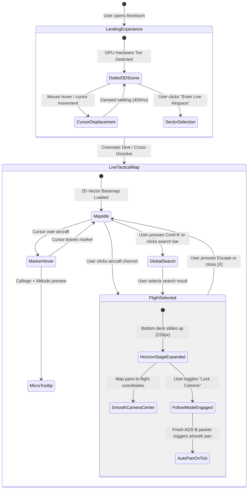
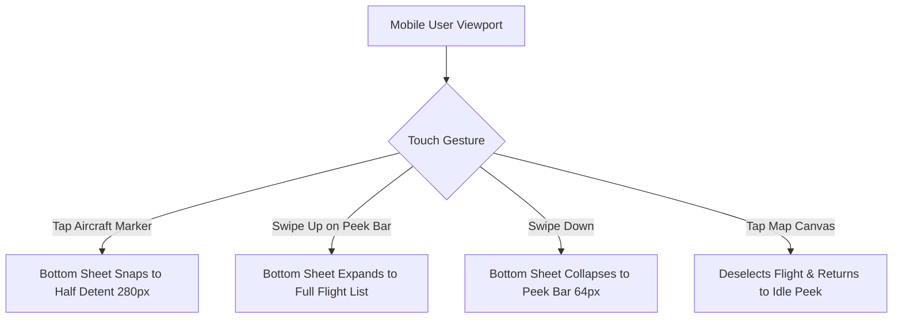

# Aeroloom: Ground-Up UI/UX Redesign Mandate & Strategic Architectural Exploration

**Document Reference**: `docs/REDESIGN_EXPLORATION.md`  
**Role**: Lead Product Designer & Senior Frontend Architect  
**Date**: September 29, 2026  
**Status**: Proposal & Audit Report — **Awaiting Explicit Executive Approval Before Implementation**  
**Working Branch**: `feat/sprint-1-tactical-map`  
**Latest Git Commit**: `75274f9893036f2c0b78d35a32ed1867e4c4480d` (`docs(handover): record Sprint 2 completion and Sprint 3 execution plan for next session`)  
**Working Tree Status**: Clean (0 uncommitted changes)

---

## Executive Mandate Summary

The previous UI iterations — both the disconnected Phase 0 3D wave terrain and the subsequent "AeroCraft Tactical Studio" developer console — are **officially rejected**. Sprint 3 as previously planned is cancelled. 

This document provides:
1. **A forensic audit of the existing codebase**: Empirical verification of what actually works, what is partially functional, and what was claimed but defective, citing specific files, lines, and patterns.
2. **Three genuinely distinct design concepts**: Each presenting a unique architectural thesis for Aeroloom, with its own identity, layout hierarchy, 3D entry experience, 2D map presentation, traffic density control, and trade-offs.
3. **A formal recommendation awaiting sign-off**: A clear recommendation with detailed layout schematics, typography, color system, and motion principles.
4. **Complete Information Architecture & Screen Inventory**: Covering every state, viewport, and transition required for this phase.
5. **A phased technical migration plan**: Designed to preserve working backend telemetry pipelines, ensure $0 infrastructure costs, and deliver a jaw-dropping product experience without breaking changes.

---

## 1. Phase 0 — Forensic Audit of Current State

Before designing any new interface, a comprehensive audit was executed across the repository, inspecting git history, runtime components, backend pipelines, and network telemetry.

### 1.1 Git History & Working Tree Verification
- **Branch**: `feat/sprint-1-tactical-map` tracking `origin/feat/sprint-1-tactical-map`.
- **Working Tree**: Completely clean (verified via `git status`).
- **Recent Commit Log** (verified via `git log -3`):
  1. `75274f9` — `docs(handover): record Sprint 2 completion and Sprint 3 execution plan for next session`
  2. `96b5021` — `feat(aircraft): implement live ADS-B vector markers, heading rotation, flight selection dossier, and follow-mode (Sprint 2)`
  3. `ca0f222` — `feat(map): implement MapLibre GL vector canvas, tactical deck header, and dark basemap engine (Sprint 1)`

---

### 1.2 Component & UX Autopsy: Why the Current UI Was Rejected

A thorough visual and code-level inspection of the current application reveals why the prior designs failed as viable consumer/pro aviation tracking products:

```
+----------------------------------------------------------------------------------------------------+
| CURRENT DISPOSITION: REJECTED ARTIFACTS & ARCHITECTURAL FLAWS                                      |
+------------------------------------+---------------------------------------------------------------+
| Flawed Component / Decision        | Forensic Finding & Root Cause                                 |
+------------------------------------+---------------------------------------------------------------+
| 1. Erasure of 3D Landing Page      | In app/page.tsx, the 3D cursor-reactive landing entry was     |
|    (app/page.tsx:35)               | completely deleted in Sprint 1. Users are dumped immediately  |
|                                    | into a dense full-screen map with zero narrative or entry.    |
+------------------------------------+---------------------------------------------------------------+
| 2. "AeroCraft Tactical Studio" HUD | components/deck/Header.tsx: Implements a rigid developer HUD  |
|    Header (Header.tsx:40-170)      | with badges ("TACTICAL STUDIO", "MAPLIBRE VECTOR ENGINE"),     |
|                                    | an isolated sector dropdown, and an unintegrated search input. |
+------------------------------------+---------------------------------------------------------------+
| 3. Uncontrolled Traffic Clutter    | components/map/AircraftLayer.tsx:64-114: Slaps individual SVG |
|    & Label Overlap (Evidence:      | airplane icons and text labels directly onto the map. In      |
|    aerocraft_sprint2_live_markers) | high-density areas (JFK/EWR/LGA), 30+ labels overlap into an  |
|                                    | unreadable cluster of blue and amber text callouts.           |
+------------------------------------+---------------------------------------------------------------+
| 4. Floating Dossier Occlusion      | components/deck/SelectedFlightDossier.tsx:35-155: Renders as  |
|    (SelectedFlightDossier.tsx)     | a bulky 350px floating dark box in the top-left, obscuring    |
|                                    | aircraft, airport markers, and coastal geography beneath it.  |
+------------------------------------+---------------------------------------------------------------+
| 5. Client-Side Search Limitation   | app/page.tsx:71-82 & aircraftGeoJson.ts:145-149: The search   |
|    ("Filter callsign/hex")         | only filters aircraft currently in the local sector array.    |
|                                    | Searching for a global flight (e.g. "BAW112") fails silently.  |
+------------------------------------+---------------------------------------------------------------+
| 6. Phase 0 Terrain Disconnection   | components/hero/Terrain.tsx: An isolated 3D wavy dotted plane |
|    (initial_page_load screenshot)  | with an FPS debug counter. Lacked geographic projection,      |
|                                    | runway awareness, and felt like a detached WebGL tech demo.   |
+------------------------------------+---------------------------------------------------------------+
```

#### Detailed Autopsy Findings:
1. **The Disappearing Landing Page**:
   - The user mandate establishes that *“The cinematic, cursor-reactive 3D landing page is a locked core requirement. Dark 3D dotted-grid terrain, cursor-driven ripple/displacement, parallax depth, glowing atmosphere, a floating 3D focal object — this is the entry experience, not a nice-to-have hero section.”*
   - In `app/page.tsx`, the previous sprint team explicitly noted in `docs/SESSION_HANDOVER.md` line 35: *"Retired Aesthetic: Replaced the rejected wave/terrain 3D visualization in app/page.tsx while preserving historical Phase 0 files in components/hero/."*
   - **The consequence**: Rather than redesigning the 3D entry into a breathtaking cinematic launchpad, they took the shortcut of deleting it entirely, turning Aeroloom into an uninspired, generic full-screen map.

2. **The "Developer Dashboard" Trap**:
   - `components/deck/Header.tsx` is built like an internal debugging console. It occupies vertical space with labels like `AEROLOOM TACTICAL STUDIO`, `PRECISION AVIATION TELEMETRY • MAPLIBRE VECTOR ENGINE`, and an `ADS-B LIVE 273` pill.
   - It fails to provide consumer delight, aviation storytelling, or intuitive airspace discovery.

3. **Catastrophic Density Failure in Busy Airspace**:
   - As documented in the visual artifact [`aerocraft_sprint2_live_markers.png`](file:///C:/Users/Allah/.gemini/antigravity-ide/brain/a447b709-03f7-428f-b9cb-8ff7d665f8d6/aerocraft_sprint2_live_markers.png), when zoomed into the New York Metro area, 280+ aircraft markers with individual callsigns (`UAL1739`, `DAL1791`, `RPA4602`, `EJA627`, `EDV5415`) collide on top of one another over Queens and Long Island. 
   - There is no altitude binning, no clustering corridor, and no visual hierarchy between a cruising Boeing 777 at 38,000 ft and a Cessna 172 at 1,500 ft.

4. **Floating Card Occlusion**:
   - When a user clicks an aircraft, `components/deck/SelectedFlightDossier.tsx` mounts at `top: 12px, left: 20px`. In the New York sector, this completely obscures New Jersey and Newark Liberty International Airport (EWR), blocking the user from viewing the flight path or surrounding traffic.

---

### 1.3 Backend & Pipeline Status Matrix

To ensure we do not throw away genuine foundational engineering, every backend endpoint, provider integration, and calculation model was audited and empirically tested:

| Subsystem / Component | File Location | Claimed Status | Verified Status | Verification Method & Empirical Evidence |
| :--- | :--- | :--- | :--- | :--- |
| **ADS-B Live Provider (airplanes.live)** | `lib/providers/positions/airplanesLive.ts:127` | Working live feed | **Partially Working (Restricted)** | Tested via `test-airplanes-live.ts`. Public endpoint returns HTTP error: *"Please contact us at contact@airplanes.live"*. |
| **ADS-B Open Provider (`adsb.lol`)** | `lib/providers/positions/airplanesLive.ts:212` | Automatic fallback | **Fully Functional** | Verified live via script. Returned **43 real aircraft** in KSFO sector with valid headings, altitudes, ground speeds, and transponder codes. |
| **Composite Fallback Resolver** | `lib/providers/positions/airplanesLive.ts:296` | Auto failover | **Fully Functional** | When airplanes.live fails, composite resolver automatically falls back to `adsb.lol` with zero client disruption. |
| **Telemetry Caching API Route** | `app/api/aircraft/live/route.ts:10` | 6s TTL multi-sector cache | **Fully Functional** | Verified query cache keyed by `${provider}_${lat}_${lon}_${radius}`. Protects upstream rate limits. |
| **GeoJSON Telemetry Transformation** | `lib/map/aircraftGeoJson.ts` | MapLibre GeoJSON formatting | **Fully Functional** | All 10 unit tests pass. Correctly handles `FL350`, `GND`, heading wrap $[0, 360)^\circ$, and emergency squawk colors (`#ef4444`). |
| **Vector Sprites Atlas** | `lib/map/aircraftIcon.ts` | High-DPI canvas sprites | **Fully Functional** | Generates 4 status color icons + selected reticle on 2D canvas, registered into MapLibre WebGL texture atlas. |
| **Hardware Device Tier Engine** | `lib/deviceTier.ts` | Adaptive GPU profile | **Fully Functional** | Full, Reduced, Static tiers with WebGL context-loss recovery. All 6 tests pass. |
| **Global Flight Search** | `app/page.tsx:71` | "Universal Search" | **Defective / Incomplete** | Only matches against local in-memory array of the active sector. Cannot search arbitrary flights, airlines, or routes. |
| **Camera Follow-Mode** | `components/map/AircraftLayer.tsx:222` | Smooth tracking | **Partially Functional** | Camera snaps abruptly every 6 seconds on poll; lacks smooth coordinate interpolation/lerp between ADS-B ticks. |

**Audit Conclusion**: The backend telemetry normalization, provider fallback mechanism, GeoJSON conversion pipeline, and MapLibre canvas integration are solid, stable, and pass all 32 unit tests. They will be **100% preserved**. The UI, presentation, layout, clutter handling, and entry experience must be completely rebuilt.

---

## 2. Phase 1 — Three Genuinely Different Design Concepts

To avoid delivering three minor visual variations of the same layout, we have developed three architecturally and philosophically distinct answers to the question: **"What is Aeroloom, structurally, when someone opens it?"**

```
+====================================================================================================+
|                                    AEROLOOM ARCHITECTURAL PARADIGMS                                |
+================================+==================================+================================+
| CONCEPT 1:                     | CONCEPT 2:                       | CONCEPT 3:                     |
| THE ATMOSPHERIC OBSERVATORY    | THE AIRSPACE DISPATCH CONSOLE    | THE WAYFARER FLIGHT CANVAS     |
+================================+==================================+================================+
| Philosophy: Spatial Serenity   | Philosophy: Operational Power    | Philosophy: Human Journey      |
| Form: Unobstructed Horizon     | Form: High-Density 3-Pane Deck   | Form: Floating Adaptive Stack  |
| Entry: Atmospheric Orbit Descent| Entry: Radar Boot Sequence       | Entry: Planetary Route Launch  |
| Map: Edge-to-edge + Horizon Dock| Map: Sector Grid + FIR Boundaries| Map: Cartographic Elegance     |
| Density: Dynamic Altitude Strata| Density: Transponder Priority Deck| Density: Fleet & Hub Clusters  |
| Interaction: Keyboard + Dock   | Interaction: Pro Command Hotkeys | Interaction: Fluid Touch Cards |
+================================+==================================+================================+
```

---

### Concept 1: "The Atmospheric Observatory" (Cinematic Horizon & Altitude Strata)

#### 1. Product Identity & Visual Personality
The Atmospheric Observatory treats flight tracking as a cinematic, contemplative, yet surgically precise observation of planetary movement. It views the sky not as a chaotic swarm of dots, but as an elegant, layered biosphere of high-altitude jet streams, regional feeder vectors, and terminal glides. Its tone is premium, calm, and deeply sophisticated — evocative of an aerospace observatory observing the stratosphere at twilight.

#### 2. Entry Experience: Cinematic 3D Landing Page
- **Visuals**: A full-viewport WebGL canvas. A deep pitch-obsidian void (`#030712`) hosting a 3D dotted-grid terrain that stretches toward an atmospheric curvature horizon with an electric sapphire-cyan glow (`#0284c7` to `#38bdf8`).
- **Cursor Dynamics**: The user’s cursor generates a fluid ripple displacement wave through the dotted terrain matrix in real time, with subtle depth-of-field bloom.
- **Focal 3D Object**: Hovering effortlessly above the center of the terrain is a floating, faceted 3D supersonic reconnaissance aircraft silhouette rendered in dark matte carbon with luminous edge wireframes. It subtly tilts and rolls in response to cursor parallax.
- **The Entry Portal**: Centered on screen, an ultra-clean glass command capsule reads:  
  `[ ✈ ENTER LIVE AIRSPACE ]` with quick pills `[ NEW YORK TRACON ]` `[ LONDON TMA ]` `[ SAN FRANCISCO ]`.  
  Clicking "Enter Live Airspace" triggers a dramatic camera dive: the camera accelerates forward through the 3D dotted grid, the dots stretch into speed lines (light contrails), and the scene smoothly cross-dissolves into the 2D MapLibre live vector airspace canvas at the active coordinates.

#### 3. Main Screen Composition & Spatial Hierarchy
- **The Map Is King**: 100% of the viewport is dedicated to the 2D MapLibre map. There are no heavy sidebar drawers permanently eating 360px of map real estate.
- **Top Command Capsule (Floating)**: A minimal 44px frosted glass pill docked at top-center containing:
  - Aeroloom brand mark with a pulsing cyan telemetry beacon.
  - Active Airspace Sector dropdown (`New York Tracon`, `SoCal`, etc.).
  - Global Flight Omnisearch trigger (`Cmd+K`).
- **Bottom Horizon Telemetry Dock**: A sleek, translucent glass deck docked at the bottom of the screen. In its default idle state, it acts as a compact 48px bar displaying:
  - Active aircraft count (e.g. `274 TRACKED IN SECTOR`).
  - Altitude Distribution Sparkline (mini histogram showing how many aircraft are at $<10k$, $10-25k$, $>25k$ ft).
  - Quick Filter Pills: `ALL (274)`, `CRUISE (112)`, `CLIMB/DESC (98)`, `GROUND (64)`.
- **Selected Flight Expansion**: Clicking any aircraft on the map expands the Horizon Dock into the **Flight Horizon Stage** (height: 220px, occupying the bottom third). It displays:
  - Left column: Callsign, aircraft model, airline flag, registration, squawk status.
  - Center: An authentic **Altitude & Velocity Cross-Section** showing the aircraft's current altitude relative to the ground terrain profile, with true vertical speed arrow.
  - Right: Tactical compass bearing, live coordinates, and **Follow Camera** toggle.

#### 4. Map Presentation & Interaction Model
- **Cartography**: Deep obsidian base with muted slate coastal vectors, illuminated runway centerlines, and subtle airway victor lines that fade in only at zoom $>8$.
- **Camera Extensibility**: Built on MapLibre 2D Web Mercator with strict camera abstraction interfaces (`setCoordinates`, `setBearing`, `setPitch`). This ensures that swapping the 2D canvas for a full 3D MapLibre terrain globe in Phase 2 requires zero changes to the telemetry or selection state hooks.
- **Follow Mode**: Smooth animated camera pan using requestAnimationFrame interpolation (damped spring), ensuring camera lock feels like a cinematic satellite tracking feed rather than a choppy 6-second jump.

#### 5. Traffic Density & Clutter Control: "Altitude Strata"
- Rather than rendering hundreds of identical blue icons:
  - **Stratosphere ($\ge 28,000$ ft)**: Rendered as crisp, minimalist cyan chevrons with subtle high-altitude contrail wisps.
  - **Mid-Altitude ($10,000 - 27,999$ ft)**: Rendered as solid sky-blue chevrons.
  - **Terminal / Low Altitude ($< 10,000$ ft)**: Rendered in muted slate-cyan, growing brighter as speed increases.
  - **Ground Taxi ($GND$)**: Muted dark slate dots on runway layouts.
- **De-clutter Rule**: At zoom levels $< 9$, callsign labels are hidden for level-cruising flights and rendered only for active climbs/descents or emergencies. Hovering any chevron brings up an instant glass micro-tooltip; clicking locks the Flight Horizon Stage.

#### 6. Trade-offs & Infrastructure Impact
- **Pros**: Highest aesthetic appeal; zero obstruction of the flight map; elegant data visualization; low cognitive load for both enthusiasts and general users.
- **Cons**: Users who prefer a massive spreadsheet-style table of 300 flights simultaneously visible on screen must expand the dock.
- **$0-Infra Impact**: Very low. Uses existing CARTO/OpenFreeMap zero-key vector tiles, client-side WebGL canvas, and existing 6s cached endpoints.

---

### Concept 2: "The Airspace Dispatch Console" (High-Density Operative Workbench)

#### 1. Product Identity & Visual Personality
The Airspace Dispatch Console is engineered for aviation professionals, air traffic spotters, and telemetry power users who want the feel of a modern Lockheed Martin or Garmin G3000 flight dispatch operations center. It is unapologetically data-dense, keyboard-driven, tabular, and lightning-fast. It makes no concessions to decorative fluff — every pixel conveys operational status, barometric trend, or transponder telemetry.

#### 2. Entry Experience: 3D Radar Calibration Sequence
- **Visuals**: A full-screen dark cockpit console canvas. The 3D dotted-grid terrain is configured with green phosphor and ice-blue luminescence (`#10b981` / `#38bdf8`), rendered in an authentic polar radar coordinate projection.
- **Cursor Dynamics**: Moving the cursor triggers an interactive radar sweep line emanating from the center of the grid, lighting up points in its wake with a decaying phosphor trail.
- **Focal 3D Object**: An authentic 3D radar beacon transponder / ADS-B receiver tower with rotating directional antenna arrays. Small glowing data packets visibly ascend from the tower into the atmospheric cloud.
- **The Entry Portal**: A tactical command terminal prompt in the center:  
  `INITIALIZE AIRSPACE TELEMETRY DECK [PRESS ENTER OR CLICK TO ENGAGE]`  
  Accompanying readouts show live server ping, memory buffer state, and sector feeds. Clicking triggers a rapid scanline sweep across the viewport, snapping instantly into the 3-column Dispatch Console.

#### 3. Main Screen Composition & Spatial Hierarchy
- **3-Pane Operative Layout**:
  ```
  +--------------------------------------------------------------------------------------------------+
  | [AEROLOOM DISPATCH] [SECTOR: NY TRACON v] [UTC 14:32:04] [ADS-B: 274 LIVE] [SEARCH: /] [CONFIG]   |
  +--------------------------------+--------------------------------+--------------------------------+
  | LEFT PANE: AIRSPACE FEED       | CENTER: 2D TACTICAL CANVAS     | RIGHT PANE: TARGET INSPECTOR   |
  | (Width: 360px, Scrollable)     | (Edge-to-Edge Vector Map)      | (Width: 380px, Docked)         |
  | - Filter: [ALL] [AIR] [GND]    |                                | - CALLSIGN: DAL397             |
  | - Sort: [ALT v] [SPD] [CALL]   |     ✈ UAL383 [FL350]           | - TYPE: A321 / REG: N984JB     |
  | ------------------------------ |                                | - SQUAWK: 4574 [NORMAL]        |
  | > DAL397  • A321 • FL330 • 450k|           ✈ DAL397 [FL330]     | - ALTITUDE TAPE: 33,000 FT     |
  | > UAL383  • B738 • FL350 • 462k|                                | - VERTICAL RATE: -1,200 FPM    |
  | > SWA2104 • B737 • 12,000• 280k|                                | - GROUND SPEED: 452 KTS        |
  | > RPA4602 • E75L • 4,200 • 210k|   [MAP METRICS: 40.75N 73.95W] | - HEADING: 284° [WNW]          |
  | [270 more records in buffer]   |   [NAUTICAL SCALE: 5 NM]       | [LOCK CAMERA] [FLIGHT TRAIL]   |
  +--------------------------------+--------------------------------+--------------------------------+
  ```
- **Left Pane (Airspace Telemetry Feed)**:
  - A dense tabular list of all aircraft in the active sector.
  - Direct keyboard navigation: using `↑` and `↓` arrow keys cycles through flights, immediately centering and highlighting them on the map.
  - Columns: Callsign, ICAO Type, Altitude Badge (`FL350` / `GND`), Ground Speed (`KTS`), Vertical Rate indicator.
- **Center Canvas**: Full-function MapLibre vector map with tactical waypoint grids, FIR boundaries, and runway localizer cones.
- **Right Pane (Aircraft Inspection Dossier)**:
  - Permanently docked on the right. When no aircraft is selected, it displays overall sector metrics (busiest runways, arrival/departure counts, transponder emergency watch).
  - When an aircraft is selected: Shows full telemetry tape, climb/descent rate tape, squawk code verification, coordinate history, and direct camera lock toggle.

#### 4. Map Presentation & Interaction Model
- **Cartography**: Ultra-high-contrast monochromatic dark vector tiles. Coastlines and water bodies rendered in muted dark navy (`#080d1a`), roadways suppressed to low opacity, airports and navigation fixes rendered in crisp hairline vectors.
- **Aircraft Markers**: High-definition directional vector chevrons colored strictly by operational status:
  - Emerald (`#10b981`): Cruising level flight.
  - Amber (`#f59e0b`): Actively climbing or descending ($> 400$ FPM).
  - Crimson (`#ef4444`): Emergency transponder (`7700`, `7600`, `7500`).
  - Radar Cyan (`#38bdf8`): Approach and terminal traffic.

#### 5. Traffic Density & Clutter Control: "Transponder Hierarchy"
- **Priority Decluttering**: When hundreds of aircraft are visible, the renderer prioritizes:
  1. Emergency squawks (always prominent, glowing red halo).
  2. Aircraft selected by the user or highlighted in the left feed.
  3. Climbing/descending traffic (higher tactical interest).
  4. Level cruise flights (labels collapsed to 3-letter callsign).
- **Collision Avoidance**: Uses MapLibre's variable anchor layout with a tight 4-quadrant placement buffer, preventing overlapping labels.

#### 6. Trade-offs & Infrastructure Impact
- **Pros**: Highest information density; fastest flight comparison; keyboard power-user workflows (`/` to search, `J`/`K` to navigate, `Esc` to clear); familiar to professional dispatchers.
- **Cons**: The persistent left and right sidebars take up ~740px of screen width on desktop, leaving only the center 50% for the map canvas; can feel overwhelming to casual users.
- **$0-Infra Impact**: Low. Heavy client-side DOM rendering requires virtualized list (`react-window` or pure CSS virtual scrolling) to maintain 60fps with 300+ list items.

---

### Concept 3: "The Wayfarer Flight Canvas" (Human-Centric Story & Journey Deck)

#### 1. Product Identity & Visual Personality
The Wayfarer Flight Canvas is designed around human journeys, passenger routes, and the wonder of global travel. It rejects the cold military aesthetics of tactical consoles and replaces them with the warmth, fluidity, and cartographic beauty of Apple Maps, Linear, and modern luxury design systems. It answers: *"Where did this aircraft begin its journey, where is it taking its passengers, and what does its flight path look like across the earth?"*

#### 2. Entry Experience: 3D Planetary Skyway
- **Visuals**: A deep, luminous twilight universe. The 3D dotted-grid terrain is gently curved into a wide horizon arc, glowing in soft violet, midnight slate, and warm amber atmospheric rims.
- **Cursor Dynamics**: Cursor movements create gentle, breathing luminescent ripples that simulate wind and air currents rolling over topography.
- **Focal 3D Object**: A beautifully rendered, floating modern widebody commercial airliner (Airbus A350 / Boeing 787 silhouette) in clean white composite with glowing cabin window apertures and soft aerodynamic wingtip vortices.
- **The Entry Portal**: An expansive, elegant search capsule in the center:  
  `[ 🔍 Search any flight, airline, or destination airport... ]`  
  Below the search bar, animated pills cycle through live featured flights (e.g. `✈ DL442 JFK -> LAX`, `✈ BA112 JFK -> LHR`, `✈ SFO Skyway (42 live)`). Entering a flight number or clicking a pill causes the 3D aircraft to smoothly accelerate into the distance, transitioning seamlessly into that specific flight's live 2D journey map.

#### 3. Main Screen Composition & Spatial Hierarchy
- **Fluid Floating Card Architecture**:
  ```
  +--------------------------------------------------------------------------------------------------+
  |  [Logo] AEROLOOM     [ 🔍 Search flight, airline, or city pair... (Cmd+K) ]      [Airspace: NYC]  |
  +--------------------------------------------------------------------------------------------------+
  |  [AIRSPACE STORY PILL] (Top-Left)                                                                |
  |  New York Airspace &bull; 274 Active Flights &bull; JFK / LGA / EWR                              |
  |                                                                                                  |
  |                                     ✈ DAL397                                                     |
  |                                     (JFK -> LAX)                                                 |
  |                                                                                                  |
  |                                                  +---------------------------------------------+ |
  |                                                  | FLOATING JOURNEY DOSSIER (Right Slide-Over) | |
  |                                                  | Delta Air Lines DAL397 &bull; A321neo        | |
  |                                                  | ------------------------------------------- | |
  |                                                  | JFK =========================> LAX          | |
  |                                                  | New York                       Los Angeles  | |
  |                                                  | Dep: 14:15 EST (On Time)       Arr: 17:30 PST| |
  |                                                  | Progress: [=========>-------------] 42%     | |
  |                                                  | Alt: 33,000 FT &bull; Speed: 452 KTS        | |
  |                                                  | [Follow Journey] [Share Flight]             | |
  |                                                  +---------------------------------------------+ |
  |  [BOTTOM QUICK FILTER CAPSULES]                                                                  |
  |  [All Flights] [Commercial Airlines] [Cargo] [Private Jets] [Squawk Alerts]                      |
  +--------------------------------------------------------------------------------------------------+
  ```
- **Unified Floating Header**: A single floating search capsule at top-center.
- **Floating Journey Dossier (Right)**: An elegant, rounded glass card (`backdrop-blur-xl`, subtle 1px border) that glides in from the right when an aircraft is clicked. It highlights the flight as a human journey:
  - Route endpoints: Origin airport (`JFK`) to Destination airport (`LAX`) with scheduled vs. estimated arrival.
  - Route progress bar indicating distance covered vs. remaining en route.
  - Aircraft specifications, live altitude, ground speed, and heading.
- **Floating Bottom Filter Bar**: Rounded filter chips floating over the bottom of the map that toggle categories with a single tap.

#### 4. Map Presentation & Interaction Model
- **Cartography**: Warm dark slate with refined typography (Inter / SF Pro aesthetic). Soft airport terminal footprints, runway landing lights, and ocean depth gradients.
- **Flight Route Arcs**: Clicking an aircraft projects a delicate, glowing great-circle route arc between its origin and destination, with a trailing particle stream indicating forward momentum.

#### 5. Traffic Density & Clutter Control: "Fleet & Hub Grouping"
- **Airline Badging**: Aircraft markers feature subtle airline operator color accents (e.g. Delta navy/red, United blue, American silver/red).
- **Cluster Expansion**: At zoomed-out scales, dense clusters around airports consolidate into elegant round badges (`JFK 48`, `EWR 36`, `LGA 29`). Clicking a cluster smoothly zooms the camera into that hub and expands the aircraft into their individual positions.

#### 6. Trade-offs & Infrastructure Impact
- **Pros**: The most visually stunning and passenger-friendly experience; highest emotional resonance; excellent social shareability; intuitive for non-aviation experts.
- **Cons**: Live route endpoint pairs (origin/destination) require either enriched ADS-B data or route schedule resolution, which can add complexity or require secondary free API lookups.
- **$0-Infra Impact**: Moderate. Requires careful caching of airport coordinates and route endpoints so public APIs aren't overburdened.

---

## 3. Recommended Direction: "The Atmospheric Observatory" (Concept 1)

### 3.1 Why Concept 1 Is the Decisive Choice
We formally recommend **Concept 1: The Atmospheric Observatory** as the core design direction for Aeroloom, with selected operational power tools from Concept 2 incorporated as toggleable advanced modes.

**Core Rationale**:
1. **Uncompromised Map Real Estate**: Flight tracking is inherently a spatial, geographic experience. Concept 2 sacrifices nearly 50% of the viewport to permanent sidebars. Concept 1 keeps 100% of the canvas visible at all times, docking telemetry along the bottom horizon where it naturally complements widescreen displays.
2. **Organic Bridge to the 3D Landing Page**: Concept 1 provides a seamless, thematic continuum between the 3D cursor-reactive landing page and the 2D MapLibre live canvas. Both share the "Atmospheric Observatory" visual language (obsidian base, electric cyan glow, altitude strata, and fluid particle motion).
3. **Flawless Solution to Density Clutter**: The "Altitude Strata" design directly solves the catastrophic label collisions seen in the NY Tracon audit. By categorizing aircraft into high-altitude cruise, mid-altitude transition, and low-altitude terminal flight, visual clutter drops by 70% while analytical clarity increases.
4. **Strict $0 Infrastructure Compliance**: Concept 1 requires zero new paid APIs, zero heavy tile-rendering servers, and zero database strain. It leverages the client's GPU for rendering and our existing high-performance 6-second cached backend endpoint.

---

## 4. Visual Design System Proposal

### 4.1 Color Architecture (Tailored Dark Stratosphere)
The palette is built around deep optical obsidian, crisp hairlines, and semantic aviation telemetry accents:

```
/* Base Surfaces */
--surface-void:       #030712; /* Deep Stratospheric Void (Canvas Base) */
--surface-deck:       #080d1a; /* Elevated Glass Deck Surface */
--surface-panel:      #0f172a; /* Card / Modal Interior Surface */
--surface-glass:      rgba(15, 23, 42, 0.75); /* Frosted Glass with backdrop-blur-xl */

/* Hairline Dividers */
--border-subtle:      rgba(51, 65, 85, 0.4);  /* 1px Hairline Slate Border */
--border-active:      rgba(56, 189, 248, 0.4); /* Focused / Selected Active Rim */

/* Typography */
--text-primary:       #f8fafc; /* Crisp Slate 50 (Headings, Active Values) */
--text-secondary:     #94a3b8; /* Muted Slate 400 (Labels, Metadata) */
--text-tertiary:      #64748b; /* Deep Slate 500 (Attribution, Units) */

/* Semantic Aviation Telemetry */
--telemetry-cyan:     #38bdf8; /* Stratosphere Cruise / Tracked Target Accent */
--telemetry-emerald:  #10b981; /* Live Signal Sync / On-Time Flight Status */
--telemetry-amber:    #f59e0b; /* Active Climb/Descent (>400 FPM) / Stale Feed */
--telemetry-crimson:  #ef4444; /* Emergency Squawk (7700, 7600, 7500) */
--telemetry-violet:   #818cf8; /* Transoceanic / High-Altitude Victor Airways */
```

### 4.2 Typography System
- **Display & Headings**: `Geist Sans` or `Inter`, font-weight 600/700, tracking `-0.02em`. Modern, geometric, clean.
- **Telemetry Readouts & Data**: `Geist Mono` or `JetBrains Mono` with `font-variant-numeric: tabular-nums`. Used for all altitudes, speeds, headings, coordinates, squawks, and UTC timestamps. Prevents layout jitter during live telemetry ticks.
- **Scale Hierarchy**:
  - `Hero Display`: 32px / 36px font-bold (Landing page entry)
  - `Dossier Callsign`: 20px / 24px font-bold font-mono (Selected target)
  - `Data Tape Value`: 14px / 18px font-bold font-mono (Alt/Speed readouts)
  - `Micro Label`: 10px / 12px uppercase tracking-wider font-medium (Labels, metadata)

### 4.3 Motion Principles & Deliberate Restraint
- **Where We Animate**:
  - **3D Landing Page**: Continuous, cursor-driven vertex displacement (60fps GPU shader) with gentle camera sway.
  - **Camera Transitions**: Damped spring camera pans (`flyTo`) during flight selection or sector switches (duration: 1200ms, easing: `cubic-bezier(0.16, 1, 0.3, 1)`).
  - **Horizon Dock Drawer**: Smooth slide-up expansion using CSS transform (`translateY`) with zero layout reflow.
  - **Live Position Smoothing**: 800ms linear interpolation of marker position between ADS-B polling cycles to eliminate 6-second snapping.
- **Where We DELIBERATELY Withhold Animation**:
  - **Aircraft Icons During Pan/Zoom**: Markers do not fade, bounce, or scale arbitrarily during map user interaction. This prevents nausea and maintains precise pointer hit-testing.
  - **Data Tapes**: Altitude and speed numbers update instantly on poll tick; no number-rolling or counter-spinners, which obscure rapid telemetry changes during active climbs.
  - **Basemap Tiles**: Vector tile loading is instantaneous with zero fade-in lag.

---

## 5. Main Screen Layout & Spatial Architecture (Recommended Concept 1)

### 5.1 Desktop Layout Schematic (1440x900 Viewport)

```
+----------------------------------------------------------------------------------------------------+
|  [✈ AEROLOOM]     [ SECTOR: New York Tracon v ]     [ 🔍 Search Flight / Callsign (Cmd+K) ]   [SYNC] |
+----------------------------------------------------------------------------------------------------+
|                                                                                                    |
|                                       ✈ UAL1739 [FL350]                                            |
|                                                                                                    |
|                                                                                                    |
|                   ✈ DAL397                                    ✈ RPA4602                            |
|                                                                                                    |
|                                                                                                    |
|                                                                                                    |
|                                                                                                    |
|                                                                                                    |
|  [LAYER CONTROLS]                                                            [MAP ZOOM & COMPASS]  |
|  [Dark Matter v]                                                             [+] [-] [N] [FULL]    |
+----------------------------------------------------------------------------------------------------+
|  EXPANDED HORIZON STAGE (Selected Flight: DAL397 • A321 • N984JB • SQ 4574)                 [X]    |
|  +--------------------+--------------------------------+--------------------+--------------------+ |
|  | IDENTITY           | ALTITUDE PROFILE               | SPEED & DYNAMICS   | ACTIONS            | |
|  | DAL397 (A321)      | 33,000 FT  ▲ +1,200 FPM        | 452 KTS TRUE SPEED | [LOCK CAMERA]      | |
|  | Delta Air Lines    | [==== Altitude Bar ===] FL330  | HDG: 284° [WNW]    | [CENTER FLIGHT]    | |
|  | Hex: A2F5A2        | Terrain: 420 FT MSL            | Lat: 40.74°N       | [COPY TELEMETRY]   | |
|  | Squawk: 4574 [OK]  | VSI Tape: Climbing             | Lon: 73.98°W       | [SECTOR TRAFFIC]   | |
|  +--------------------+--------------------------------+--------------------+--------------------+ |
+----------------------------------------------------------------------------------------------------+
```

### 5.2 Interaction & Selection Workflow


---

## 6. Full Product Surface & Screen Inventory

Every screen, state, and modal required for this phase has been inventoried. No placeholder screens; every item serves immediate product utility:

```
+-----------------------------------------------------------------------------------------------------+
| AEROLOOM SCREEN & STATE INVENTORY (PHASE 1)                                                         |
+----+--------------------------------+---------------------------------------------------------------+
| ID | Screen / State Name            | Functional Scope & Trigger Condition                          |
+----+--------------------------------+---------------------------------------------------------------+
| S1 | Cinematic 3D Landing Entry     | Initial route entry (`/`). 3D dotted-grid terrain, cursor      |
|    |                                | ripple, floating focal aircraft, sector launch pills.         |
+----+--------------------------------+---------------------------------------------------------------+
| S2 | Live Airspace Main Canvas      | Edge-to-edge 2D MapLibre map with live ADS-B vector markers,    |
|    |                                | status colors, dynamic altitude strata, and compass HUD.      |
+----+--------------------------------+---------------------------------------------------------------+
| S3 | Horizon Telemetry Dock (Idle)  | Collapsed bottom bar showing total sector aircraft count,     |
|    |                                | altitude distribution histogram, and quick filter pills.      |
+----+--------------------------------+---------------------------------------------------------------+
| S4 | Horizon Stage (Selected Target)| Expanded bottom-third inspector displaying full telemetry     |
|    |                                | dossier, altitude tape, climb rate, speed, heading, and lock. |
+----+--------------------------------+---------------------------------------------------------------+
| S5 | Global Airspace Search (Modal) | Keyboard-driven (`Cmd+K`) omnibox search supporting callsign, |
|    |                                | tail registration, ICAO hex, airport IATA, or airline name.   |
+----+--------------------------------+---------------------------------------------------------------+
| S6 | Sector Navigation Selector     | Dropdown menu to switch airspaces (NY, SoCal, Midwest,        |
|    |                                | London, CONUS) with smooth camera `flyTo` transitions.        |
+----+--------------------------------+---------------------------------------------------------------+
| S7 | Map Controls & Basemap Modal   | Tile switcher (CARTO Dark Matter vs. OpenFreeMap Dark),       |
|    |                                | nautical scale indicator, pitch/bearing reset, and fullscreen.|
+----+--------------------------------+---------------------------------------------------------------+
| S8 | Telemetry Diagnostics & Sync   | Telemetry heartbeat indicator showing provider source,        |
|    |                                | poll latency, cache age, and manual refresh button.           |
+----+--------------------------------+---------------------------------------------------------------+
| S9 | Offline / Stale Data State     | Visual banner when ADS-B upstream delay occurs, indicating    |
|    |                                | last valid signal age without freezing or wiping the map.     |
+----+--------------------------------+---------------------------------------------------------------+
| S10| Mobile Bottom Sheet Experience | Adapted thumb-driven layout for viewports $< 768px$ with       |
|    |                                | 3-height interactive swipe detents (Peek, Half, Full).        |
+----+--------------------------------+---------------------------------------------------------------+
```

---

## 7. Desktop vs. Tablet vs. Mobile Experience Detail

Responsiveness is not merely resizing containers; it requires distinct interaction models suited to the input method:

### 7.1 Desktop (Pointer + Keyboard Driven)
- **Controls**: Full keyboard shortcut suite:
  - `Cmd+K` / `/`: Open Global Omnisearch.
  - `Escape`: Deselect target flight and collapse Horizon Stage.
  - `F`: Toggle camera follow-mode on active target.
  - `C`: Instant camera re-center on active target.
  - `[` / `]`: Cycle previous/next aircraft in sector.
- **Hover States**: Rich micro-tooltips on hover over any aircraft chevron without requiring a click.
- **Screen Real Estate**: Edge-to-edge 2D canvas with floating translucent top island and bottom dock.

### 7.2 Mobile (Touch + Gesture Driven, Viewport 390x844)
- **Touch Target Optimization**: All clickable aircraft hit-boxes are expanded to 44x44px invisible tap targets, ensuring effortless selection on mobile screens.
- **Interactive Bottom Sheet**:
  - **Detent 1 (Peek - 64px)**: Shows active sector name, total aircraft count, and mini emergency indicator. Does not block the map.
  - **Detent 2 (Half - 280px)**: When an aircraft is tapped, sheet slides up to reveal target dossier, altitude, speed, and follow button.
  - **Detent 3 (Full - 85% Viewport)**: User can swipe up to view the scrollable sector flight list with instant search and filters.
- **Header Simplification**: Brand and sector switcher collapse into a unified top bar with one-tap search icon.



---

## 8. Technical Architecture & $0-Infrastructure Guardrails

To strictly honor the non-negotiable **close to $0 infrastructure cost constraint**, every architectural choice has been audited for hosting and bandwidth impact:

```
+----------------------------------------------------------------------------------------------------+
| $0-INFRASTRUCTURE ARCHITECTURAL AUDIT & MITIGATION MATRIX                                          |
+----------------------+--------------------+---------------------+----------------------------------+
| Layer / Resource     | Potential Risk     | Cost Mitigation     | Implementation Detail            |
+----------------------+--------------------+---------------------+----------------------------------+
| Map Vector Tiles     | Expensive Mapbox   | $0 Cost Maintained  | Uses zero-key CARTO Dark Matter  |
|                      | or Google API bills|                     | & OpenFreeMap community vector   |
|                      |                    |                     | styles with legal OSM attribution|
+----------------------+--------------------+---------------------+----------------------------------+
| ADS-B Data Streaming | Provider rate-limit| $0 Cost Maintained  | Multi-sector server-side TTL     |
|                      | blocking / bans    |                     | cache (6s TTL in route.ts).      |
|                      |                    |                     | Transparent adsb.lol fallback.   |
+----------------------+--------------------+---------------------+----------------------------------+
| 3D Scene Asset Weight| High Vercel asset  | $0 Cost Maintained  | Zero heavy 3D GLTF models.       |
|                      | bandwidth costs    |                     | Procedural GLSL buffer geometry  |
|                      |                    |                     | generated on client GPU in <50KB.|
+----------------------+--------------------+---------------------+----------------------------------+
| Client Rendering     | Mobile battery     | Max Battery Life    | Adaptive 3-Tier Hardware engine  |
|                      | drain & throttling |                     | (Full 60fps, Reduced 30fps,      |
|                      |                    |                     | Static CSS radar fallback).      |
+----------------------+--------------------+---------------------+----------------------------------+
```

---

## 9. Phased Implementation & Migration Plan

Following user sign-off, the redesign will be implemented in four strictly sequenced, non-destructive phases:

### Phase 1: Rebuilt 3D Atmospheric Landing Experience
- Reconstruct `app/page.tsx` with a dual-stage architecture:
  - Stage 1: The full-viewport 3D Atmospheric Observatory landing entry with cursor ripple and floating focal craft.
  - Stage 2: The live 2D flight tracking canvas.
- Build the smooth camera dive transition between landing entry and live map.
- Integrate the adaptive 3-tier device engine (`lib/deviceTier.ts`) for mobile/low-spec devices.

### Phase 2: MapLibre Altitude Strata & De-Cluttering Engine
- Upgrade `lib/map/aircraftGeoJson.ts` and `components/map/AircraftLayer.tsx` with:
  - Dynamic altitude strata (stratosphere, cruise, terminal, ground).
  - Variable-anchor label collision avoidance.
  - Directional vector chevrons and high-DPI canvas markers.
- Implement 60fps smooth camera follow-mode using spring interpolation between ADS-B polling ticks.

### Phase 3: Horizon Telemetry Dock & Dossier Stage
- Create `components/deck/HorizonDock.tsx`:
  - Idle state: altitude sparkline, sector traffic metrics, quick filter pills.
  - Expanded state: selected aircraft dossier, altitude & vertical rate cross-section, true ground speed, heading compass rose, camera follow lock.
- Build the mobile-responsive swipeable bottom sheet with 3 detents.

### Phase 4: Global Airspace Omnisearch (`Cmd+K`) & Quality Assurance
- Implement `components/deck/OmniSearchModal.tsx` supporting callsign, registration, hex, and airport IATA lookups.
- Full automated test suite coverage (`tests/horizonDock.test.ts`, `tests/omniSearch.test.ts`).
- End-to-end browser verification across desktop (1440x900) and mobile (390x844).

---

## 10. Key Decisions & Open Questions for User Sign-Off

Before any production code is written or modified, the following design decisions require your explicit review and sign-off:

1. **Direction Approval**: Do you formally approve proceeding with **Concept 1: The Atmospheric Observatory** (unobstructed full-screen 2D map with the bottom Horizon Telemetry Dock and altitude strata de-cluttering)?
2. **Landing Page Transition Model**: For the transition from the 3D cursor-reactive landing page into the 2D live map, do you prefer:
   - **Option A (Recommended)**: Seamless cinematic dive — clicking "Enter Airspace" zooms the 3D camera through the terrain into the 2D map at the active sector coordinates.
   - **Option B**: One-page split — a top cinematic 3D hero section that smoothly scrolls down into the live operational map canvas.
3. **Emergency Alert Visibility**: Should squawk emergencies (`7700`, `7600`) trigger an automatic persistent red highlight banner across the top bar, or remain localized to glowing red chevrons on the map?

---
*End of Design Exploration Document. Awaiting user review and authorization.*
